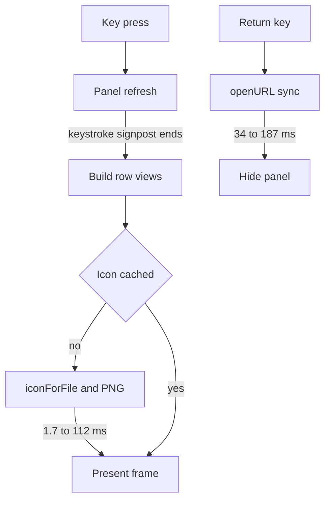

# Spec: meet the frame and memory budgets

Status: proposed. No fix in this spec is built. The latency session of item 1 exists as uncommitted measurement tooling. Measured on 2026-11-26 at commit `e0abc84`, Apple silicon, macOS 27.3.

## At a glance

Nanospot misses five of its six budgets because blocking macOS calls run on the main thread inside a frame, and because the benchmarks stop their clocks before those calls happen. This spec moves icon rendering and the open call off the frame, makes each benchmark end at the presented frame, and runs two probes that decide whether the memory targets are reachable. The largest single miss is a 285 ms summon after Session Retention expired. Its cause is in nanoui's frame scheduling, and item 8 lists four nanoui patches. Search ranking, the File Index format, the clipboard store, and Session Retention behaviour stay unchanged.

## Budgets

| Budget | Target | Measured | Verdict |
| --- | --- | --- | --- |
| Peak footprint | under 67 MB | 174 MB in the bench, 215 MB in the installed app | miss |
| Idle footprint | under 23 MB | 57 MB expired, 71 to 76 MB retained, 104 MB installed app | miss |
| Typing, key to pixels, new rows | under 16 ms | 44 to 47 ms p50, 55 to 81 ms p99 with an empty icon cache | miss |
| Typing, key to pixels, same rows | under 16 ms | 4 to 6 ms p50 | pass |
| Open home folder | under 16 ms | 34 ms p50, 187 ms worst | miss |
| Summon after Session Retention expired | under 8 ms | 285 ms p50, 382 ms p99 | miss |
| Summon inside Session Retention | under 8 ms | 12 ms p50, 31 ms p99 | miss |
| Switch from search to the board | under 8 ms | 10 to 23 ms p50, 37 ms p99 | miss |
| File, folder, app launch | under 8 ms | same call as "open home folder" | miss |

Footprint means `phys_footprint`, the number in Activity Monitor's Memory column.

The owner confirmed these meanings on 2026-11-26:

- **Summon** runs from the hot key to the first presented frame.
- **App launch** runs from Return on a selected app row, such as Antigravity, to the moment Nanospot hands the open to macOS and hides.
- **Opening a folder or file** runs from Return on a found folder or file row, such as the home folder, to the same hand-off. A folder opens in Finder.

The opened app's own startup time, Finder's included, belongs to that app and is outside these budgets.

## Background

A frame at 120 Hz lasts 8.3 ms. Work that blocks the main thread for longer than that drops a frame.

The panel builds its view on the main thread. Each visible row asks the shell for an icon. On a cache miss the shell calls `NSWorkspace iconForFile:`, renders a `CGImage`, encodes it to PNG, and returns the bytes. nanoui then decodes the PNG again. A keystroke that brings eight new rows into view pays that cost eight times before the frame can present.

Return calls `NSWorkspace openURL:` on the main thread. That call is a synchronous round trip to Launch Services, and the panel hides only after it returns.

The `keystroke` signpost ends at Panel publication, before the view is built. So the existing numbers report 0.02 to 3.4 ms for a keystroke and never see the icon cost. The bench budget for a first frame with icons is 46 ms, which is 5.5 frames.

### What already meets its budget

Leave these alone. A change here cannot move a budget.

| Path | Measured | Budget |
| --- | --- | --- |
| Core search, 705k entries, 14 queries | 0.6 to 7.3 ms p99 | 16 ms |
| Keystroke to publication, real app | 0.02 to 3.4 ms | 16 ms |
| Board keystroke, 5,000 entries | 0.93 ms p99 | 16 ms |
| `stat` per row | 0.002 ms p50 | 16 ms |
| Footprint at launch, panel never shown | 20.1 MB | 23 MB |
| `frontmostApplication`, pointer screen, user defaults | under 0.15 ms | 8 ms |

## Rules for the implementer

1. Time the suspect in the real app before you write its fix.
2. When a fix shows no measured gain, delete it.
3. Split a number by stage before you fix it.
4. Report p50 and p99 over at least 30 samples. The latency session takes 30 per metric.
5. Record a refuted hypothesis with its numbers, so nobody tests it twice. Item 4 lists three.

## Work items

Do them in this order. Item 1 is the gate for every later claim.

### 1. Make the clocks end at the pixels

**Problem.** `make check` holds no measurement of key to presented frame, Return to panel hidden, or a switch between search and the clipboard board.

**Exists, uncommitted.** `scripts/bench-nanoui-latency.sh` runs the app with `--nanospot-latency-session`. `app/src/latency_probe.zig` drives 30 rounds of summon, a keystroke that brings new rows, a keystroke that keeps the rows, a switch to the board, and a hide. Each interval ends in `afterFrame` on a frame that holds a display-link drawable. It prints `NANOSPOT_LATENCY metric=… p50_us=… p99_us=…`. `NANOSPOT_RETENTION_SECONDS` sets Session Retention, and `NANOSPOT_LATENCY_IDLE_MS` sets the hidden time between rounds.

**Change.**

- Review the probe, then commit it or rewrite it.
- Run it against a 700k-entry index from `nscore synth`. Today it uses the memory session's seeded catalog.
- Add Return to panel hidden as a metric. The `--nanospot-latency-open` flag times only the `open` call.
- Add the session to `make check` with the budgets from the table above.
- Lower the bench budget for a first frame with icons from 46,000 µs to 8,000 µs.
- Lower the memory script's idle budget from 60 MB to 23 MB, and add a 67 MB check on `phys_footprint_peak`.

**Done when** `make check` fails on today's code for each missed budget in the table above.

### 2. Take icon rendering off the frame

**Problem.** A row's first icon costs 1.66 ms warm and 3.64 ms cold at p50, with a 112 ms worst case. PNG encoding is 1.5 ms of the 1.66 ms: the same fetch without encoding costs 0.15 ms.

In the real app, a keystroke that brings new rows presents after 44 to 47 ms at p50 when the icon cache is empty. The same keystroke takes 7.5 ms at p50 once the cache holds those rows, and a keystroke that keeps its rows takes 4 to 6 ms. The 40 ms gap matches the icon cost, but no trial has removed the icons to prove it. Stub `appIcon` to return null and rerun the session before building the fix.

**Change.**

- On a cache miss, draw the existing symbol tile in that frame and request the icon.
- Render requested icons on a background thread and redraw when one lands. Drop a result whose row has left the view.
- Remove the PNG round trip if nanoui accepts raw pixels. If it does not, keep the encode on the background thread.

**Done when** keystroke to presented frame stays under 16 ms at p99 with an empty icon cache, and no frame calls `iconForFile:` on the main thread.

### 3. Hand the open to macOS without waiting

**Problem.** `openURL:` blocks the main thread for 34 ms at p50 and 187 ms at worst. `openURL:configuration:completionHandler:` returns in 0.014 ms at p50 for the same folder.

**Change.**

- Hide the panel first, then call the asynchronous open.
- Log a failed open from the completion handler.
- Apply the same change to "Show in Finder" after timing it. It is unmeasured.

**Done when** Return to panel hidden is under 8 ms at p99 for an app, a file, and the home folder.

### 4. Split summon by stage, then fix the slow stage

**Problem.** A summon after Session Retention expired takes 285 ms at p50. A summon inside Session Retention takes 12 ms.

**Cause, confirmed.** The pixels arrive on time, but the panel stays at alpha 0.01. nanoui presents the first display-link drawable through its retained redraw, which does not call the app's `afterFrame`. The reveal waits for `afterFrame` on a presenting frame, so it waits for the next unrelated full frame. Item 8.1 holds the trace, the trial, and the patch.

Measured over 30 summons each, 250 ms hidden between rounds:

| Stage | Retention 0 s | Retention 300 s |
| --- | --- | --- |
| Hot key to window placed (`summon_placed`) | 7 to 10 ms p50 | 6 ms p50 |
| Hot key to first frame callback (`summon_built`) | 285 ms p50 | 12 ms p50 |
| Hot key to presented frame (`summon`) | 285 ms p50, 382 ms p99 | 12 ms p50, 31 ms p99 |

The wait sits between window placement and the first frame callback. Nanospot's own code runs for under 10 ms of it. The first callback is also the presenting frame, so view build and draw are not the slow stage.

The two paths differ in Panel Presence. A retained panel has a valid last frame and orders in seen. An expired panel orders in unseen and waits for its first frame.

**Refuted.** Each trial changed one thing in `app/src/main.zig`, ran the session, and was reverted.

| Hypothesis | Trial | Cold summon p50 | Verdict |
| --- | --- | --- | --- |
| The 250 ms entrance fallback timer gates the frame | `entrance_timeout_ms` 250 to 60 | 288 ms | no gain |
| The surface released at expiry must reallocate | skip `releaseSurface` on `release_idle` | 303 ms | no gain |
| macOS throttles a window ordered in at alpha 0.01 | `entrance_alpha` 0.01 to 1.0 | 250 ms | 12% gain, 215 ms to the first callback |

The cold summon varied between sessions: 285 ms, 131 ms with 250 ms more hidden time, and 119 ms in the traced build. The confirmed cause explains the spread, because the reveal waits for whichever full frame comes next.

**Change.**

- Land item 8.1, then run the latency session again.
- The 12 ms retained summon and the 10 to 23 ms switch still miss 8 ms. `summon_placed` alone costs 6 to 10 ms and holds three view builds that cannot present. Item 8.2 covers them.
- After 8.1 and 8.2, split what remains of `apply(hotKey)`: window frame set, order-in, Panel publication.

**Done when** summon and the search-to-board switch are each under 8 ms at p99, cold and retained, or the timestamps show a display-refresh wait that no code change can remove.

### 5. Probe the open-panel GPU floor

**Problem.** Footprint rises from 20 MB to 174 MB when the panel shows. 97.4 MB of that is "Owned physical footprint (unmapped) (graphics)", and it appears only while the panel is visible. The peak target is 67 MB.

**Change.** Build a probe window of the board's size and record its footprint in four cases: with and without the glass slab, and at the search size and the board size.

**Done when** the probe names how many of the 97 MB belong to macOS. If the floor alone exceeds 67 MB, stop and return the decision to the owner: keep the glass slab, or keep the 67 MB target.

### 6. Return to the launch footprint when hidden

**Problem.** A hidden panel holds 71 to 76 MB during Session Retention and 57 MB after expiry. Launch state is 20.1 MB, so the 23 MB target needs nearly everything back.

What remains after expiry: Malloc Small 25.6 MB against 11.8 MB at launch, 8.6 MB unmapped, 6.6 MB IOSurface, 5.4 MB IOAccelerator. Malloc Small also grows about 2 MB per open and close cycle: 21.4, 23.6, 25.5 MB.

**Change.**

- Attribute the heap growth first. Run the memory session with `MallocStackLogging=lite` and compare `heap` output between cycle 1 and cycle 3. 18 MB of the installed app's 29 MB live heap has no type name today.
- Free what the attribution names.
- Release GPU surfaces at hide, not at expiry, and keep only the query, filter, and selection for the retention window.

**Blocked by item 8.1.** Releasing at hide makes every summon a cold summon, which costs 285 ms today. Land the cold-summon patch first. Without it, the 23 MB idle target and the 8 ms summon target cannot both hold.

**Done when** the footprint is under 23 MB at hide plus 2 seconds, and Malloc Small does not grow between cycle 1 and cycle 3.

### 7. Create the Full Disk Access guide on first use

**Problem.** Launch creates the guide window and renders its icon in every session, including sessions where access is already granted.

**Change.** Create the guide window, its drag source, and its icon when the grant flow first shows it.

This item is a hypothesis. Time the launch stages first, and drop the item if the guide costs under 1 ms and under 1 MB.

### 8. Patch nanoui

nanoui 0.9.2 comes from a release tarball named in `app/build.zig.zon`. The unpacked copy in `app/zig-pkg/` is ignored by Git, so an edit there does not ship. Send each patch upstream to `justrach/nanoui`, or pin a fork in `build.zig.zon`. Paths below are inside the nanoui package.

#### 8.1 Call the frame callback on a retained redraw

**Problem.** Trace of one cold summon, in milliseconds after the hot key:

| Time | Event |
| --- | --- |
| 3 to 8 | three frames build with no drawable, each calls `afterFrame(presenting = false)` |
| 8 | panel placed, display link unpaused |
| 11 to 23 | the link delivers its first drawable, and nanoui presents it by retained redraw |
| 23 to 110 | 10 to 12 link callbacks do nothing |
| 39 to 119 | a full frame runs, `afterFrame(presenting = true)` fires, and the panel reveals |

`metalDisplayLinkNeedsUpdate` at `src/ui/surface_events.zig:458` picks `redrawRetained` when the last built frame left `retained_ready` set. `redrawRetained` at `src/ui/surface.zig:381` presents the stored instances and never calls `after_frame`, which only `frameAt` calls at `src/ui/surface.zig:313`. A retained summon skips this path, because its link callback runs a full frame.

**Trial.** With the retained branch disabled by an environment switch, cold summon fell from 119 ms to 24 ms at p50 and from 465 ms to 44 ms at p99, over 30 summons each in the same build. The trial is reverted.

**Change.** Pick one after reading both call sites:

- Call `after_frame` from `redrawRetained` after a successful present, so the app learns that pixels landed.
- Or leave `retained_ready` unset until the surface has presented one full frame since it became visible.

`Shell.framePresented` at `app/src/shell.zig:360` already asks for a retry through `retry_frame`, and the trace shows the retained redraw still wins. Find out why before choosing, because the fix may belong in the app.

**Done when** cold summon and retained summon differ by under 2 ms at p50.

#### 8.2 Do not build a frame that cannot present

**Problem.** `requestFrame` at `src/ui/surface.zig:463` calls `frame()` when the link is paused. `frame()` clears `given_drawable`, so on Metal that frame builds the whole view and then cannot present. The link then builds the same view again with a drawable. A summon runs three such builds inside `summon_placed`, which costs 6 to 10 ms. Each `redraw()` on an idle panel, which includes each keystroke, runs one.

Timed since: the builds cost 0.1 to 0.6 ms per summon at p50, so this patch cannot bring summon under budget. Item 9 holds the numbers. Close it unless the p99 tail survives item 2.

**Change.** When a display link exists and the surface is visible, set `full_pending`, unpause the link, and return. Time `summon_placed` and `keystroke_same_rows` before and after.

**Done when** `summon_placed` is under 3 ms at p50, or the timing shows the builds are not the cost.

#### 8.3 Accept raw pixels for images

**Problem.** `Images.get` at `src/ui/images.zig:173` accepts only encoded bytes. It decodes them with ImageIO on the main thread inside the frame, at most 8 per frame. So Nanospot must encode each icon to PNG, and nanoui decodes it again.

**Change.** Add an entry that takes premultiplied BGRA pixels with a width and height and packs them into the atlas. Item 2 then drops the PNG round trip. The decode cost inside nanoui is unmeasured, so time `load` at `src/ui/images.zig:287` first.

**Done when** no frame decodes an image for an icon row.

#### 8.4 Measure the latency from frame to glass

**Problem.** Each link callback names a presentation time 20 ms in the future. The trace shows 19.9 to 20.8 ms on every frame. Every interval in this spec ends when the frame is handed to the link, so the pixels reach the display about 20 ms later.

**Change.** Read `preferredFrameLatency` on the `CAMetalDisplayLink` created at `src/ui/surface.zig:146`, then try a lower value and check for dropped frames. This is a hypothesis.

**Done when** the owner decides whether the budgets end at the hand-off or at the display, with the measured cost of each.

### 9. Findings from the stage trace

A temporary trace timed each stage of each interaction in the real app, 29 rounds per column. The trace is removed. Each finding has its own issue.

**Icons, proven (#163, #171).** With the icon hook switched off, a keystroke with new rows fell from 34.5 ms to 4.2 ms at p50. In a frame with 7 new icons the view build takes 26.9 ms, which holds the fetch and the PNG encode, and nanoui's decode takes 5.9 ms. That is about 3.8 ms per icon to fetch and encode and 0.85 ms to decode.

**Switch to the board (#173).** The hot-key path takes 8.3 to 9.3 ms at p50 and 23 to 28 ms at p99 before any frame is asked for. With Session Retention at 0 s the first board frame also decodes 8 thumbnails for 14.1 ms, about 1.8 ms each.

**Summon placement (#174).** A retained summon presents at 9.4 ms. Ordering the window in and making it key takes 4.6 ms at p50 and 9.2 ms at p99. A cold summon adds 3.7 ms to set the window frame. The first frame builds, lays out, and paints in under 0.3 ms.

**"Show in Finder" (#175).** The reveal call takes 17.5, 19.0, 19.7, 25.2, and 115.9 ms in a probe outside the app.

**Search scaling (#177).** On 704,910 entries, 8 threads make a query 1.0 to 3.3 times faster than one thread, and `doc` runs 2.5 times slower: 3.38 ms against 1.37 ms. Every query stays under 6 ms.

**Launch.** Process start to the run loop takes 82 to 123 ms. The guide of item 7 costs 5 to 7 ms of it.

**Refuted by this trace.**

| Idea | Measurement |
| --- | --- |
| Item 8.2, skip builds that cannot present | 2 to 3 builds per summon cost 0.1 to 0.6 ms at p50 |
| Precompile the Metal shaders | setup takes 1.5 to 2.4 ms for the first window |
| Raise the search workers' priority | same time at default, utility, and user-interactive on an idle machine |
| Hint the File Index pages before the first query | 1.0 ms with and without, while the file is cached |

Five ideas remain unmeasured, and #178 lists each with its method: the first query after real page eviction, prewarming while hidden, starting work on key-down, a smaller image atlas, and allocation scatter on 16 KB pages.

**No install step (#176).** See "Measurement conditions".

## Out of scope

- **Core search speed.** It is inside budget by a factor of two. #177 tracks its poor scaling as headroom.
- **Index build time.** A full home scan takes 10.9 s for 704,911 entries, with a 33 MB peak. It runs off the main thread and touches no budget in this spec.
- **Process launch.** This spec treats "launch" as summon.

## Measurement conditions

Every number above was taken while the installed app had no File Index, so "typing feels slow" was felt on apps and icons alone. Measure item 2 again with file rows in view.

The index was missing because Nanospot had no Full Disk Access. Two faults caused that, and both are fixed on this machine:

- The installed bundle had a broken signature. A new build had been copied on top of the old bundle, which left an old `floodlight-nanoui` executable inside it.
- LaunchServices held 16 records for deleted builds named `Nanospot.app` under the identifier `com.floodlight.nano`. System Settings resolved Nanospot to that identifier and wrote each grant there.

Since 16:00 on 2026-11-26, `com.nanospot.app` holds Full Disk Access and Accessibility, and `~/Library/Application Support/Nanospot/names.flix` exists at 29 MB.

The repository has no install step. Replace the bundle in `/Applications` whole. Do not copy a build over it.

## Diagram

Evidence, each read on 2026-11-26:

- `app/src/panel/view.zig:216` asks for an icon for every non-web row in view.
- `app/src/shell.zig:680` fetches on a cache miss, on the calling thread, up to 64 icons.
- `app/src/mac/system.zig:295` fetches the icon and encodes PNG.
- `app/src/mac/system.zig:109` calls the synchronous `openURL:`.
- `app/src/shell.zig:376` opens before `settle` hides the panel at line 383.
- `app/src/panel.zig:512` begins the keystroke signpost, and the `defer` on line 513 ends it before the view is built.
- `app/src/bench.zig:34` sets the 46,000 µs icon budget.
- `scripts/bench-nanoui-memory.sh:8` sets the 60 MB idle budget.
- `app/src/main.zig:68` releases surfaces only when the shell reports `release_idle`.
- `app/src/main.zig:411` renders the guide icon at launch, and line 419 creates the guide window.
- `app/src/main.zig:21` sets the 250 ms entrance fallback, and line 22 sets the 0.01 entrance alpha.
- `app/src/main.zig:325` names the `Nanospot` support folder.

## How the numbers were taken

| Number | Command |
| --- | --- |
| Bench latencies | `zig build bench --release` in `app/` |
| Footprint by phase | `scripts/bench-nanoui-memory.sh` |
| Installed app footprint and heap | `footprint`, `vmmap -summary`, `heap` on the running process |
| Core search and scan | `nscore index $HOME` then `nscore bench` with 14 queries |
| Icon, `stat`, and open timings | a scratch Swift probe that calls the same AppKit methods, 16 apps and 5 opens |
| Summon, keystroke, and switch to pixels | `scripts/bench-nanoui-latency.sh`, and again with `NANOSPOT_RETENTION_SECONDS=300`, 30 rounds each |
| Keystroke to publication | `log stream --signpost` during the memory session |
| Cold summon trace and the retained-redraw trial | temporary prints in nanoui's link callback, `setPaced`, and `occlusionChanged`, read against the latency session. Removed after the run. |

The Swift probe ran outside the app. The latency session does not yet time icons or the open in the app.

## ELI5

[The whole story in pictures](https://claude.ai/artifact/B7kqEqSQykVgdhLPH2e5gR). Each issue below links its own picture page at the end of its body.

## Related issues

| Item | Issue |
| --- | --- |
| All | #159 tracks the frame budget and idle memory work |
| 1 | #161 |
| 2 | #163, and #171 for the raw-pixel entry in nanoui |
| 3 | #162 |
| 4 | #169 and #170 |
| 5 | #167 |
| 6 | #166, blocked by #169 |
| 7 | #165 |
| 8 | #168 is the spec. #169 is 8.1, #170 is 8.2, #171 is 8.3, #172 is 8.4 |
| 9 | #173 board switch, #174 summon placement, #175 Show in Finder, #176 install step, #177 search scaling, #178 unmeasured ideas |
