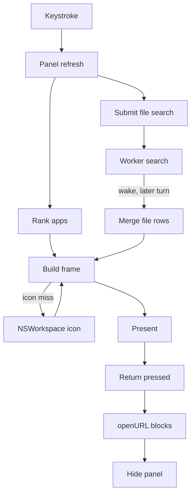

# Spec 001: Every input answers within one frame, and idle memory returns to the launch floor

> **Executor instructions**: Work the units in order. Each unit starts with a measurement and ends with a gate. If a fix shows no measured gain, delete it and record the number in `plans/README.md`. Stop and report when a STOP condition holds. Do not improvise past one.
>
> **Drift check (run first)**: `git diff --stat 2c40a82..HEAD -- app/src core/src scripts`. If a file named in the Evidence list changed, compare it with the claims here before you edit.

- **Planned at**: commit `2c40a82`, 2026-11-26
- **Category**: perf
- **Priority / Effort / Risk**: P1 / L (six units, each S or M) / MED

## At a glance

Nanospot's own logic answers in microseconds, but three blocking system calls run on the main thread inside the frame or before the panel hides, and no benchmark measures input to presented pixels. This spec adds a stage clock to the real app, moves each blocking call off the frame, and trims idle memory toward the measured 20.1 MB launch floor. Ranking, the File Index format, Session Retention rules, and the clipboard schema stay unchanged.

## Background

Nanospot is a Zig 0.17 macOS launcher on nanoui 0.9.2. `app/` holds the panel and `core/` holds the memory-mapped File Index. The display refreshes every 8.3 ms at 120 Hz. Work that finishes inside one frame is invisible. Work that blocks the main thread delays every later frame.

Terms come from `GLOSSARY.md`: **Panel Presence** (hidden, entering, shown), **Search Session**, **Session Retention** (hidden state kept for 300 s), **Result Publication** (the rows a query answers), **Selected-Result Action** (open, paste, copy, reveal), **Search Execution**, and **File Index**.

Baseline measured at `2c40a82` on the author's Mac. Each number names its command.

| What | Measured | Target | Command |
|---|---|---|---|
| Keystroke to Result Publication, apps only | p99 7 µs | n/a | `make test-nanoui` |
| Keystroke to built frame, 2,000 files, no icons | p99 202 µs | n/a | `make test-nanoui` |
| First frame with icons fetched on the frame | p50 7.15 ms, p99 15.33 ms | under 8.3 ms | `make test-nanoui` |
| File search on the real 735,256-entry index | p50 0.49 ms (`r`) to 7.63 ms (`readme`) | first frame includes hits | `nscore bench <names.flix>` |
| Clipboard board query, 5,000 entries | p50 0.73 ms | n/a | `make test-nanoui` |
| Footprint at launch, panel never shown | 20.1 MB | n/a | `make bench-nanoui-memory` |
| Footprint hidden, retention 0 | 48.3 MB | 23 MB | `make bench-nanoui-memory` |
| Footprint hidden, inside retention | 69.3 to 77.9 MB | see Unit 5 | `make bench-nanoui-memory` |
| Footprint hidden, after retention expiry | 54.7 MB | 23 MB | `make bench-nanoui-memory` |
| Footprint open, and process peak | 146.5 to 176.1 MB, peak 189.5 MB | 67 MB | `make bench-nanoui-memory` |

Not measured yet: hot key to presented frame, keystroke to presented frame, Return to window hidden, and `openURL:` duration in the real app. Unit 0 measures them. No fix in Units 1 to 4 lands before its Unit 0 number exists.

Two targets conflict with measured floors. Say so in the report instead of chasing them:

- **Cold process launch cannot finish in 8 ms.** AppKit setup alone was measured near 130 ms in an earlier session. The 8 ms budget applies to summon (hot key to presented frame) with the process already running.
- **Peak 67 MB is below one measured line item.** While the panel is open, `footprint` reports 97.4 MB under "Owned physical footprint (unmapped) (graphics)". Unit 6 finds out who owns it before anyone promises a number.

## Problem Statement

Typing in search and opening a folder feel slow. Summon, switching between search and the clipboard board, and launching a file, folder, or app must each finish within one frame. Activity Monitor shows more memory than a launcher should hold, both while hidden and while open.

## Solution

Every input produces its presented frame within the budget: 16 ms for a keystroke, 8.3 ms for summon, surface switch, and Selected-Result Action dismissal. The panel disappears the instant Return is pressed. Icons arrive without delaying a frame. File results appear in the same frame as app results when the File Index answers quickly. A hidden Nanospot that has passed Session Retention expiry holds close to its launch footprint. A gate fails the build when any of these regress.

## User Stories

1. As a Nanospot user, I want each keystroke to show its results within 16 ms, so that typing feels instant.
2. As a Nanospot user, I want file and folder rows to appear in the same frame as app rows when the index answers fast, so that the list does not reflow under my eyes.
3. As a Nanospot user, I want the panel to vanish the moment I press Return, so that opening my home folder feels instant even when Finder is slow.
4. As a Nanospot user, I want a slow or hung target app to never freeze the panel, so that I can summon Nanospot again right away.
5. As a Nanospot user, I want rows to draw with a symbol first and their icon a moment later, so that an icon fetch never delays a frame.
6. As a Nanospot user, I want files of one type to share one icon fetch, so that scrolling a long list of PDFs costs one fetch.
7. As a Nanospot user, I want the hot key to show the panel within one frame while Nanospot is running, so that summon feels like part of the system.
8. As a Nanospot user, I want switching between search and the clipboard board to finish within one frame, so that the two surfaces feel like one panel.
9. As a Nanospot user, I want a paste from the clipboard board to keep its order (write, hide, deliver), so that speed work never pastes the wrong content.
10. As a Nanospot user, I want my retained query, filter, and selection to survive a quick re-summon exactly as today, so that memory work does not cost me my place.
11. As a Nanospot user, I want hidden Nanospot to hold under 23 MB after retention expires, so that it costs nothing while I do not use it.
12. As a Nanospot user who never saw the Full Disk Access guide, I want Nanospot to never build that window, so that I do not pay for a surface I never see.
13. As a Nanospot user, I want the first query after a long idle to be as fast as the tenth, so that an evicted index does not show as a stall.
14. As the maintainer, I want one command that prints each stage of input to presented frame in the real app, so that I fix the stage that is slow instead of guessing.
15. As the maintainer, I want the latency gate to fail at the user-facing budgets (16 ms and 8.3 ms), so that a regression cannot hide under a 46 ms budget.
16. As the maintainer, I want the benchmark fixture to match my real index size, so that a number from the gate predicts what I feel.
17. As the maintainer, I want the memory gate to fail above 23 MB idle and to report peak, so that memory regressions are caught on the day they land.
18. As the maintainer, I want to know who owns the 97.4 MB graphics line, so that I stop searching in app code if macOS owns it.
19. As the maintainer, I want every fix that shows no measured gain deleted, so that the code stays simple.
20. As an implementing agent, I want each unit to name its seam, its measurement, and its gate, so that I can verify my work without judgment calls.

## Implementation Decisions

Work in this order. Units 1 to 4 are independent after Unit 0. Unit 6 can run beside any of them.

### Unit 0: Measure the real app before any fix

- Add a **stage clock**: one monotonic timestamp per stage of an interaction, taken in the running app. Stages are input received, Result Publication done, frame built, frame presented with a drawable, and action handed to macOS. The after-frame callback already knows whether a drawable was presented.
- Add a scripted **latency session** beside the existing memory session flag. It drives summon, typing, surface switch, and Return through the real window, then prints one line per interaction with each stage delta. Follow the memory session's shape: a flag, a runner, marker lines, and a shell script that parses them.
- The existing signposts end too early for this. The keystroke signpost closes when publication ends, not when pixels present. Keep the signposts and extend them to the presented frame.
- Raise the benchmark fixture from 2,000 files to an index near 750,000 entries, the size of the real one. Build it synthetically. Never read the user's home folder in a gate.
- Tighten the frame budgets to the targets: 16 ms keystroke to presented frame, 8.3 ms for summon, surface switch, and Return to hidden. A budget that fails today stays failing until its unit lands. Do not loosen a budget to make the gate green.
- Report-only suspects to time directly in this unit, because each is a guess until timed: the 50 ms delayed redraw after a panel resize, the entrance that holds the window at alpha 0.01 until its first presented frame, the `openURL:` call, app-folder scanning and clipboard pruning at launch, and the first query after the index pages were evicted.

### Unit 1: Hide first, then open, off the main thread

- Today a Selected-Result Action calls the host's open, waits for it to return, and only then settles Panel Presence to hidden. `openURL:` is a synchronous LaunchServices call. The panel stays on screen for as long as it takes.
- New order for open and reveal: settle Panel Presence to hidden, then hand the target to macOS without blocking the main thread. Use the asynchronous `NSWorkspace` open API with a completion handler, or a background queue.
- Log an open failure from the completion handler. The panel is already hidden, so no UI changes.
- The paste action keeps its exact order: write the pasteboard, hide, deliver ⌘V. Copy keeps its order too. Only open and reveal change.
- Query history and app-open counts are recorded before the action, as today.

### Unit 2: Icons never run on the frame

- Today the row view asks the shell for an icon during layout. A cache miss calls `NSWorkspace iconForFile:`, renders a `CGImage`, and encodes a PNG, all on the main thread. The measured first frame with icons is 7.15 ms p50 and 15.33 ms p99.
- The icon hook returns a cached icon or nothing, and never calls the system. A miss enqueues the path for one background worker. The row draws its symbol tile, which already exists as the fallback.
- The worker fetches and encodes, then hands the bytes to the main thread, which stores them and requests one redraw. Batch arrivals so that many icons cost one redraw.
- Cache key: the bundle path for an app, the file extension for a file, one shared key for folders. Files with a custom icon are out of scope.
- Keep the 64-entry cap and the rule that Session Retention expiry clears the cache.
- Prefetch the frequent apps' icons while hidden. The frequent rows are already rebuilt at hide.
- The worker must drop work for a session that was forgotten. Reuse the sequence-number pattern that the file search worker uses.

### Unit 3: The first frame carries file hits when the index is fast

- Today a query returns app rows at once and submits file search to a worker. File rows land through a wake on a later main-thread turn. Every keystroke publishes twice and the list reflows.
- After submitting, the main thread waits a bounded time for that sequence number. Start at 3 ms. If the worker answers in time, rank once with hits and publish once. If not, publish apps now and merge later, as today.
- Measured on the real index: 10 of 12 benchmark queries answer in under 3 ms at p50. `readme` (7.63 ms) and `lib/x` (5.21 ms) do not, and keep the two-step path.
- Supersede rules stay: only the newest query is searched, and an index swap never lands under a running search.
- Tune the wait by the Unit 0 gate. If keystroke to presented frame p99 does not improve, delete the wait.
- Investigate only, no commitment: why a longer query (`readme`) costs more than a shorter one (`rea`). The suspect is path-fallback scoring before the heap fills with name matches. Time `scoreOne` by branch before changing it.
- Investigate only: ask the kernel to page the index in at summon (`madvise` will-need) so the first query after idle does not fault. Keep it only if the Unit 0 cold-query number moves.

### Unit 4: Launch does only what the first frame needs

- Split launch into stages with the stage clock first. An earlier session found its 300 ms swings in quit, not launch.
- Create the Full Disk Access guide window, its glass slab, its drag source, and its 44 px icon only when the grant flow enters guiding. Today all four are built on every launch, even when access is already granted.
- Move the launch-time clipboard prune to the first tick of the existing hourly prune timer.
- App-folder scanning stays before the first summon, because the first frame needs app rows. Move it only if its timed cost exceeds 1 ms.
- Keep each change only if its stage delta shows a gain.

### Unit 5: Idle memory returns toward the launch floor

- Define idle as hidden and past Session Retention expiry. Inside the retention window the footprint is 69 to 78 MB by design (ADR 0015 keeps the session and its surfaces for 300 s). The 23 MB target applies after expiry.
- The gap from the launch floor at expiry is about 28 MB: Malloc Small grows from 11.7 MB to 23.9 MB, IOSurface holds 6.6 MB, and IOAccelerator holds 5.4 MB.
- Live heap at idle, from `heap -s` under `MallocStackLogging=lite`, includes ColorSync tone-curve tables (4.2 MB, created by image colour matching), a purgeable zone (2.1 MB), the paint buffer (1.0 MB), SQLite (0.6 MB), and the glyph atlas map (0.4 MB). Total live heap is 20.5 MB against 23.9 to 29 MB dirty.
- Try in this order, and re-run the memory gate after each:
  1. Unit 4's lazy guide window, which removes one surface.
  2. Free the paint buffer and the atlas maps in the idle release path.
  3. Ask SQLite to release its cache in the idle release path.
  4. Find which IOSurface and IOAccelerator regions survive the release, by size, with `vmmap`. Free them if the app owns them.
- If idle is still above 23 MB, prototype **re-exec at expiry**: the hidden process replaces itself once retention has expired and no compaction or index scan is running. Every durable state is already on disk, and a fresh process measures 20.1 MB. Measure the hot-key gap during the swap before adopting it. This is a prototype decision, not a commitment.
- Set the memory gate's idle budget to 23 MB once a step reaches it. Until then the gate prints the gap and fails.

### Unit 6: Find the owner of the open-panel graphics memory

- While open, 97.4 MB sits under "Owned physical footprint (unmapped) (graphics)". It is constant across cycles and disappears on hide.
- Known app-side graphics allocations are far smaller: nanoui's image atlas is 2048 × 2048 BGRA (16 MB) and its glyph atlas starts at 2048 × 2048 single-channel (4 MB).
- Build a throwaway probe matrix and measure footprint for each cell: glass slab clear, glass slab regular, visual-effect fallback, no effect view, and an opaque window. Delete the probe after recording the numbers.
- If the line belongs to the glass effect or to macOS, record it as the platform floor and revise the 67 MB target. If the app owns it, write a follow-up spec.
- A smaller image atlas needs a nanoui change. nanoui is pinned at v0.9.2. Do not fork it in this spec.

## Testing Decisions

- A good test asserts what a user or the host can observe: the order of host calls, the rows published, whether a hook touched the system. It does not assert private fields.
- Highest seam, used first: the windowless shell with a fake host. Unit 1 asserts that hide is requested before open is handed over, and that paste keeps write, hide, deliver. Prior art: the shell and state-machine suites.
- Unit 2 uses the panel hooks seam: a fake icon hook counts system fetches per frame and the test asserts zero during layout. Prior art: the panel suite's hook fakes and the benchmark's frame hooks.
- Unit 3 uses the catalog's injectable search function. One test answers inside the wait and asserts one publication with file rows. One test answers late and asserts apps first, then a merge. Prior art: the three worker tests beside the catalog.
- Units 0, 4, 5, and 6 are verified by gates, not unit tests: the latency session script and the memory script, both run against the release bundle.
- Watch each new test fail once with its behaviour missing before it passes.
- Gates after every unit: `make check` exits 0, `make test-nanoui` prints every `NANOSPOT_BENCH` line inside budget, and `make bench-nanoui-memory` prints its verdict.

## Out of Scope

- Changing ranking, scoring constants, or the File Index on-disk format.
- Changing Session Retention rules or its 300 s default.
- Forking or patching nanoui.
- Incremental File Index updates. The full-scan refresh is a recorded gap in ADR 0010.
- Icons for files with a custom icon.
- Paste delivery timing. It sleeps on the main thread after the panel is hidden, and that is a separate question.
- Cold process launch under 8 ms. The platform floor makes it unreachable.

## Further Notes

**STOP conditions**

- A Unit 0 number shows a suspect costs under 1 ms. Skip that fix and record the number.
- A change needs a nanoui edit.
- Two fixes that share one assumption both fail their gate. Test the assumption before a third.
- The memory or latency gate cannot run on your machine. Report which command failed and its output.

**Considered and rejected**

- SQLite writes on Return: the store runs WAL with `synchronous=NORMAL`, so a commit does not sync to disk.
- Per-row `stat` and date formatting: the built frame with both costs 202 µs at p99.
- Clipboard board query on switch: 0.73 ms for 5,000 entries.
- A persistent search thread pool: a whole query including its spawns costs 0.49 ms.
- A two-process split (tiny agent plus on-demand UI): cold UI launch breaks the summon budget.

**Repo conventions**

- Run `make install-zig` once, then `make check` after every unit. `make format` formats.
- Layout numbers live in the token tables in the chrome and board modules. No raw layout literals at call sites.
- A comment states why, never what. Do not edit Markdown or existing comments outside this spec's scope.
- Commits follow `type(scope): summary`, for example `fix(clipboard): measure short clipboard queries in Unicode scalars`. One commit per unit. Do not push.

**Evidence** (read at `2c40a82`)

- `app/src/shell.zig:373-384`: the action runs before Panel Presence settles to hidden.
- `app/src/mac/system.zig:109-114`: open calls synchronous `openURL:`.
- `app/src/shell.zig:680-695`: the icon hook fetches on a cache miss, on the caller's thread.
- `app/src/panel/view.zig:215-219`: the row view calls the icon hook during layout.
- `app/src/mac/system.zig:295-305`: `iconForFile:`, `CGImage`, then PNG encoding.
- `app/src/search.zig:239-246`: a query submits to the worker and returns app rows only.
- `app/src/main.zig:102-109`: worker results reach the panel through a main-queue dispatch.
- `app/src/panel.zig:496-527`: the keystroke signpost closes at publication.
- `app/src/main.zig:143-151`: a resize schedules a redraw 50 ms later.
- `app/src/main.zig:338-342`, `:360`, `:404-425`: app scan, prune, and the guide window run at launch.
- `app/src/mac/window.zig:238-252`: the idle release path.
- `app/src/bench.zig:29-36`: frame budgets of 4.3 ms, 46 ms, and 1.5 ms.
- `scripts/bench-nanoui-memory.sh:8`: the idle budget is 60 MB, and peak has no gate.
- `core/src/search.zig:258-298`: a query spawns up to seven threads above 200,000 entries.
- `docs/adr/0015-session-retention.md`: retention keeps hidden state for 300 s.
- nanoui 0.9.2 `src/ui/images.zig:14`: the image atlas side is 2048.
